# File Browser

The File Browser lets you browse, create, rename, delete, upload, download, and extract files on an agent.

To access: **Right click** on an agent > **Remote Background** > **File Browser**:

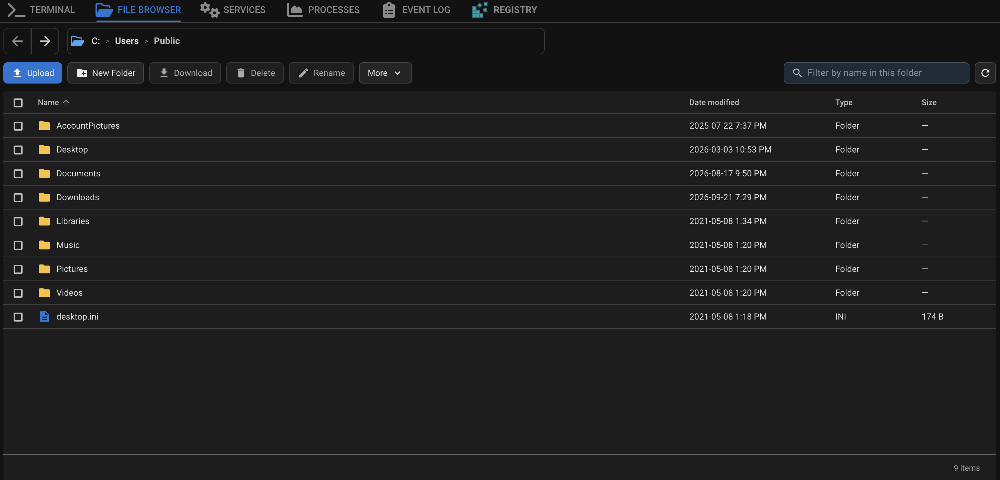

## Permission

File Browser access is controlled by the *Use File Browser* permission (*Settings > Permissions Manager*). Without it, the tab shows a lock message.

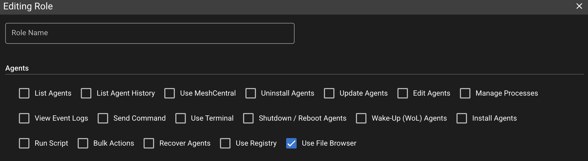

Roles that already had *Use MeshCentral* were given *Use File Browser* when this permission was added. New roles need the box ticked. Super Users still have all permissions.

## Browse and Navigate

When you open File Browser, it starts in the first default folder the agent can open:

- Windows: `%PUBLIC%` (usually `C:\Users\Public`), then `Users\Public`, `Users`, or a drive root
- Linux: `/home`, then `/`
- macOS: `/Users`, then `/`

The path bar shows that location. Use back / forward, click a breadcrumb, or click the path to type an absolute path and press Enter.

Refresh reloads the current folder. If a name filter is active, Refresh keeps the filter.

Columns are Name, Date modified, Type, and Size. Folders stay at the top when you sort. Names sort as 1, 2, 10 (not 1, 10, 2). A file that is still uploading is hidden from the list until it finishes.

### Large Folders

The first load shows about **500** items. Scroll near the bottom to load more. Loading stops after about **10,000** items in that folder. The footer shows how many are loaded when more remain.

### Filter by Name

*Filter by name in this folder* matches names in the **current folder only** (not subfolders, not file contents). Matching is a case-insensitive part of the name.

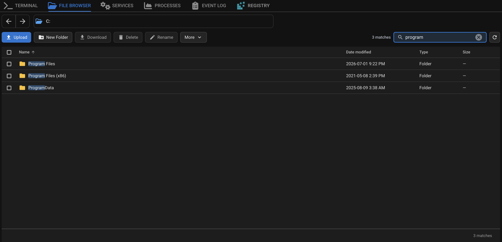

- Same-folder Refresh keeps the filter
- Navigate, back, forward, opening a folder, or switching agent clears it
- Escape, the search X, or *Clear filter* reloads the full listing
- Ctrl+F (Cmd+F on Mac) focuses the filter when the File Browser tab is visible

## File Operations

Toolbar, *More* menu, and row right-click:

| Action | Notes |
|---|---|
| New Folder | Creates a folder in the current path |
| Rename | One selected item |
| Delete | One or many items, up to **100** at a time. System folders (for example `C:\Windows`, `/etc`, drive roots) and the agent's own files cannot be deleted |
| Properties | Details for one selected item. Large or deep folders may show a partial summary |
| Copy Path | Copies the full path (or paths) |
| Extract to… | One `.zip` file, see [Extract ZIP](#extract-zip) |

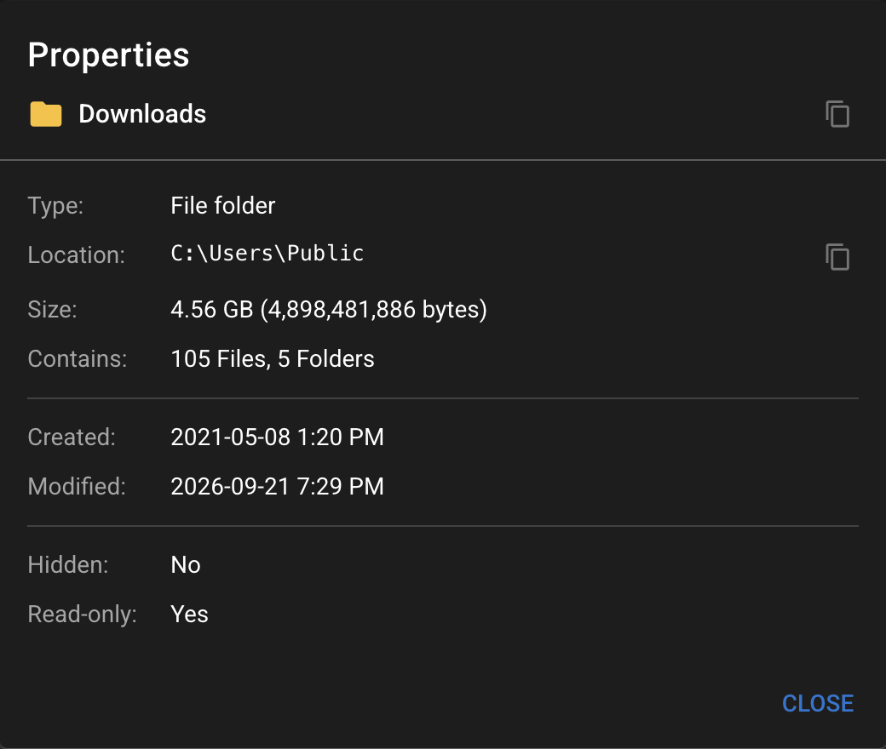

Names cannot contain `\ / : * ? " < > |` or control characters, cannot be `.` or `..`, and cannot be longer than **255** characters (the agent counts bytes, so names with non-Latin characters may be refused sooner). On Windows agents, names also cannot end with a space or a period, and cannot be a reserved device name (`CON`, `PRN`, `AUX`, `NUL`, `COM0`-`COM9`, `LPT0`-`LPT9`, with or without an extension).

Every New Folder, Rename, Delete, upload, download, ZIP download and extract is recorded in the Audit Log (*File > Audit Log*) with the user, agent and paths.

## Upload

Use Upload or drag files onto the file table (not the path bar, toolbar, or transfer queues). Folder drops are not supported. If a drop mixes files and folders, the files can still be queued.

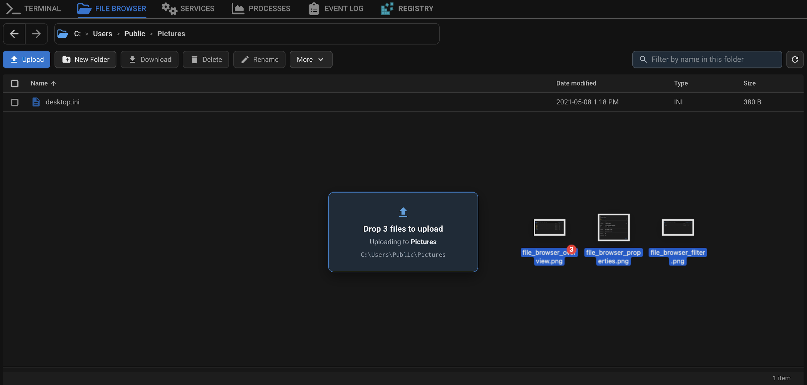

- Up to **100** files per pick or drop. If you pick more, the first 100 are queued; if you drop more, the drop is refused
- Up to **500** items in the upload queue
- File size is unlimited by default (see [Customizing Limits](#customizing-limits)). If a limit is set, the upload queue shows it and larger files are skipped
- The agent must have enough free disk space for the file, or the upload is refused before it starts

One File Browser tab uploads one file at a time. Other queued files wait.

Only one upload to the same file can be active at a time. If another upload to that file is running or paused (for example in another tab, or by another technician), the new one is refused until the first is finished or cancelled.

### Name Conflicts

If some names already exist in the folder, one dialog covers the whole set:

- *Cancel upload* - nothing is queued
- *Skip existing* - skip names that already exist; upload the rest (those remaining files will not overwrite if a matching name appears later)
- *Replace existing* - overwrite names that already exist after a successful transfer

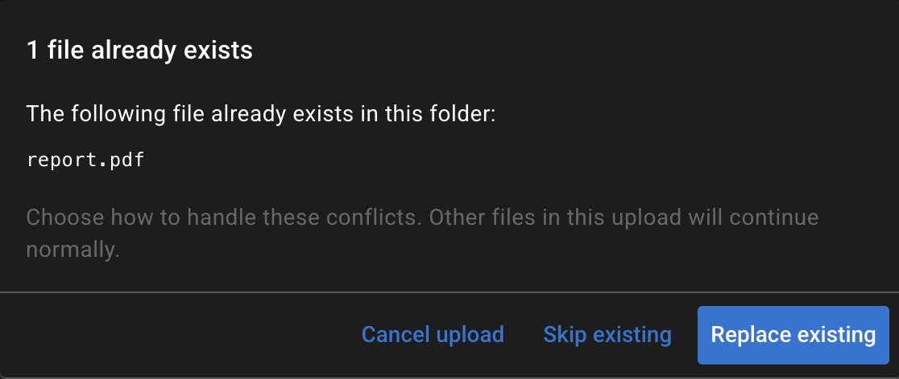

### Queue

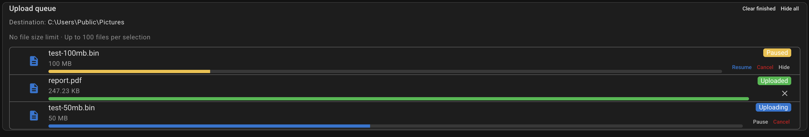

| Control | Behavior |
|---|---|
| Pause | Stops the transfer. You can Resume for about **1 hour** from last progress. If the transfer had already started, it still counts toward the per-agent / per-user limit |
| Cancel | Stops the transfer, frees the slot, and removes the temporary `.partial` file on the agent |
| Hide / Hide all | Hides paused rows; they still count on the Transfers badge |
| Dismiss / Clear finished | Removes completed, failed, and cancelled rows from the list |

Uploads are written as `filename.partial` on the agent and renamed when the transfer completes successfully.

## Download

| Selection | What happens |
|---|---|
| 1 file | Progress panel |
| 2-10 files (files only) | Sequential download queue, one at a time |
| Any folder, or more than 10 files | ZIP archive (one transfer), after a *Download as ZIP?* confirmation |

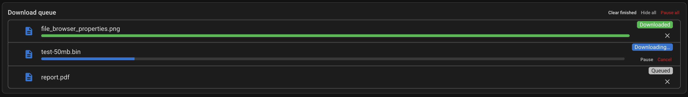

The download queue holds up to **100** items.

### Folder / ZIP Download

The agent builds a temporary ZIP, then downloads it like a normal file. *Building archive…* means the ZIP is still being prepared. A ZIP download can't start while other downloads are in progress.

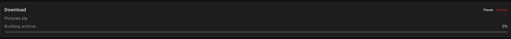

If some nested items could not be included (symlinks, files locked by another program, pipes or device files, or folders more than **32** levels deep), the rest of the ZIP is still built and a warning appears when the download finishes. The temp ZIP is deleted when the transfer completes, is cancelled, or expires.

By default, ZIP downloads are limited to **100** items in the selection, **10,000** files, **4 GB** uncompressed, and **32** folders deep. The agent also refuses if there isn't enough free disk space in its temp folder for the ZIP (on Windows, `C:\ProgramData\TacticalRMM` unless [changed](settings_override.md#configuring-custom-temp-dirs-on-windows-agents); on Linux and macOS, the system temp folder, usually `/tmp`, unless `tmpdir` is set in `/etc/tacticalagent`).

### Browsers

- **Chrome / Edge:** save directly to disk. Resume after a page refresh works; the browser may ask you to allow access to the file again.
- **Firefox / Safari:** the file is buffered in memory, capped at **512 MB**. Use Chrome or Edge for larger downloads. A copy is kept in the browser's storage so the download can resume after a page refresh, unless the browser's storage limit is reached (the download then continues, but cannot resume after a refresh).

The download queue supports Pause, Resume, Hide, Dismiss, Pause all, and Clear finished. If a download fails (not Pause), that slot is freed so you can try again.

## Extract ZIP

To unpack a `.zip` file on the agent, right-click it and choose *Extract to…*, or select it and use *More* > *Extract to…*. The ZIP is extracted by the agent; nothing is transferred through your browser.

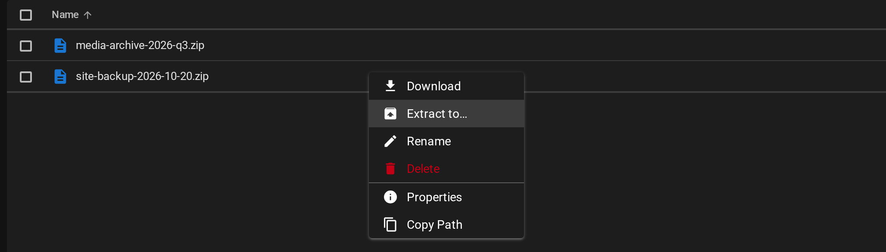

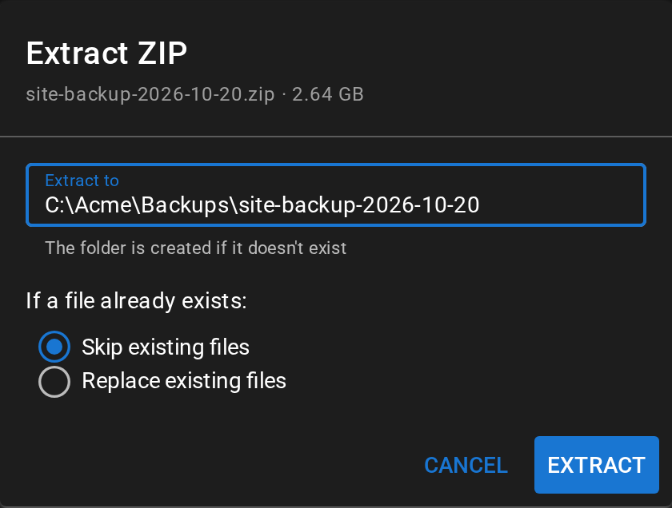

- *Extract to* is filled in with a folder named after the ZIP, next to it. You can change it to any full path. The folder is created if it doesn't exist; if it exists, the files are added to it. It can't be an existing file or a link
- *If a file already exists*: *Skip existing files* (default) leaves the existing file alone, *Replace existing files* overwrites it. Where the ZIP has a file and the destination has a folder with the same name (or the other way round), that item is always skipped

A progress panel shows how much has been written and how many files are done. You can close or refresh the page: the extraction keeps running on the agent, and the panel comes back when you open the File Browser for that agent again. When it finishes, a message shows how many files were extracted and skipped.

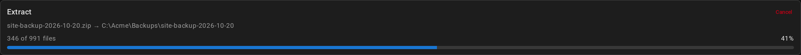

*Cancel* stops the extraction. Files already extracted are kept, and the file that was being written is removed. If the agent goes offline or restarts during an extraction, it is stopped and reported as failed after about 10 minutes without word from the agent; files extracted until then are kept.

Some items in a ZIP are skipped, and listed in a warning when the extraction finishes:

- symbolic links and other special files
- names that would end up outside the destination (for example `../file` or `C:\file`), or that contain `:`
- names that are not valid on the agent (see the naming rules under [File Operations](#file-operations))
- duplicate names; the first one in the ZIP is kept. On Windows and macOS, names that differ only by upper/lower case count as duplicates
- items that would have to go through a link or junction already in the destination

The extraction is refused, before anything is written, if the ZIP:

- is password-protected
- uses a compression method other than Store or Deflate (for example LZMA or BZip2, which 7-Zip can produce)
- has more than **10,000** files, more than **4 GB** of uncompressed data, or folders more than **32** levels deep (see [Customizing Limits](#customizing-limits))
- needs more free disk space than the destination has

A damaged ZIP, or one whose contents are larger than it claims, stops the extraction with an error; files extracted before that point are kept. If nothing in the ZIP could be extracted (for example, the agent isn't allowed to write to the destination), the extraction is reported as failed, with the first reason.

File modification times are restored from the ZIP (times stored without a time zone, as Windows' own zip tools write them, are read as the agent's local time). On Linux and macOS, file permissions recorded by Linux and macOS zip tools are kept (a private file stays private), except setuid, setgid and sticky; files from other tools get read/write for the owner and read for everyone else, plus execute if they were marked executable. Names in ZIPs made by older Windows tools (not UTF-8) are read as code page 437.

An extraction uses one of the transfer slots described in [Concurrent Transfers](#concurrent-transfers-waiting-for-slot) while it runs. It does not wait for a slot: if none is free, it is refused with a message. Each extraction is recorded in the Audit Log with the ZIP, the destination and the *If a file already exists* choice.

## Resume, Refresh, and Other Tabs

Paused transfers and the toolbar Transfers badge survive a page refresh. Transfers are **not** started automatically after reload.

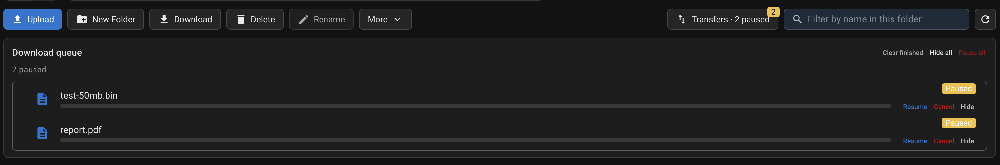

- Resume window is **1 hour**, renewed as the transfer makes progress. A running transfer only times out if it moves less than about 25 MB in an hour
- After refresh, an upload needs *Select file*. Pick the same file (name, size, and date modified)
- Firefox / Safari downloads can resume after refresh unless the browser's storage limit was reached (see [Browsers](#browsers))
- If another browser tab is already working on that item, Resume / *Select file* may show *Open in another tab*. Cancel still works from any tab
- Hide does not remove the item from the paused count on the badge

## Connection Problems

Transfers recover from short outages on their own: network drops, a server restart or update, or the agent restarting. You don't need to do anything.

- *Waiting for agent…* appears when no data has arrived for 30 seconds. This is normal on a very slow agent connection, where one chunk can take longer than that
- *Reconnecting…* appears when the transfer has stalled (about 2.5 minutes without progress, for example after an agent restart). The transfer is paused and resumed automatically, retrying every 15 seconds while the agent is still unreachable
- *Connection lost. Click Resume to continue.* appears if 5 automatic attempts in a row make no progress. The transfer stays paused and can be resumed within the resume window

## Concurrent Transfers (Waiting for Slot)

How many items sit in the queue is not the same as how many can run at once.

By default each agent can have **3** transfers in progress (all users combined), and each user can have **10** across all agents. Extra new uploads or downloads wait instead of failing. The queue row shows *Waiting for slot…* until a slot frees or you Pause / Cancel. If no slot frees up within about 8 minutes, the item fails with a message and can be started again. Both limits can be changed, see [Customizing Limits](#customizing-limits).

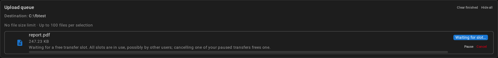

- Resuming an existing transfer does **not** take a new slot
- Pause after a transfer has started still holds a slot
- Pause before it starts does not
- Cancel or finish a started transfer to free a slot
- You can only see and cancel your own transfers. If another user holds the slots, wait for them to finish
- A transfer that was started but never moved any data (for example the browser tab was closed) frees its slot after 10 minutes

## Customizing Limits

The limits above can be changed by adding any of the following variables to `/rmm/api/tacticalrmm/tacticalrmm/local_settings.py`:

| Variable | What it controls | Default |
|---|---|---|
| `FILE_TRANSFER_MAX_SESSIONS_PER_AGENT` | Transfers in progress per agent, all users combined. `0` means unlimited | 3 |
| `FILE_TRANSFER_MAX_SESSIONS_PER_USER` | Transfers in progress per user, across all agents. `0` means unlimited | 10 |
| `FILE_BROWSER_MAX_UPLOAD_FILE_SIZE_BYTES` | Largest file that can be uploaded, in bytes. `0` means unlimited | 0 |
| `FILE_TRANSFER_SESSION_TTL_HOURS` | Resume window for a paused or interrupted transfer, in hours | 1 |
| `FILE_TRANSFER_IDLE_EXPIRE_MINUTES` | How long a transfer that never moved any data holds its slot, and how long an extraction may go without word from the agent before it is reported as failed, in minutes | 10 |
| `FILE_TRANSFER_SESSION_RETENTION_HOURS` | How long finished transfers are kept in the database, in hours | 24 |
| `FILE_BROWSER_MAX_ARCHIVE_FILES` | Most files in one ZIP download | 10000 |
| `FILE_BROWSER_MAX_ARCHIVE_SIZE_BYTES` | Largest total uncompressed size of one ZIP download, in bytes | 4294967296 (4 GiB) |
| `FILE_BROWSER_MAX_ARCHIVE_DEPTH` | Deepest folder level included in a ZIP download | 32 |
| `FILE_BROWSER_MAX_ARCHIVE_PATHS` | Most selected items in one ZIP download | 100 |
| `FILE_BROWSER_ARCHIVE_BUILD_TTL_MINUTES` | How long the agent may take to build a ZIP, in minutes | 60 |
| `FILE_BROWSER_MAX_EXTRACT_FILES` | Most files in one ZIP that is extracted | 10000 |
| `FILE_BROWSER_MAX_EXTRACT_SIZE_BYTES` | Largest total uncompressed size of one ZIP that is extracted, in bytes | 4294967296 (4 GiB) |
| `FILE_BROWSER_MAX_EXTRACT_DEPTH` | Deepest folder level in a ZIP that is extracted | 32 |
| `FILE_BROWSER_MAX_DELETE_PATHS` | Most items in one delete | 100 |
| `FILE_BROWSER_PROPERTIES_MAX_FILES` | Files counted by folder Properties before it shows a partial summary | 100000 |
| `FILE_BROWSER_PROPERTIES_MAX_DEPTH` | Deepest folder level counted by folder Properties | 32 |
| `FILE_BROWSER_PROPERTIES_MAX_DURATION_SECONDS` | Time allowed for a folder Properties summary, in seconds (at most 40) | 20 |

Example:

```python
FILE_TRANSFER_MAX_SESSIONS_PER_AGENT = 5
FILE_TRANSFER_MAX_SESSIONS_PER_USER = 20
FILE_BROWSER_MAX_UPLOAD_FILE_SIZE_BYTES = 2 * 2**30  # 2 GiB
```

After adding/editing values, run `sudo systemctl restart rmm celery celerybeat` for changes to take effect.

!!!note
    The ZIP download, extract, delete and Properties file and depth limits can be lowered but not raised: the agent (for delete, the web UI) enforces the defaults as the maximum, so higher values have no effect. The same applies to `FILE_BROWSER_ARCHIVE_BUILD_TTL_MINUTES`, because the web UI stops waiting for a ZIP after 60 minutes. `FILE_BROWSER_PROPERTIES_MAX_DURATION_SECONDS` can be raised up to 40.

    Raising `FILE_TRANSFER_SESSION_TTL_HOURS` above 1 hour only helps downloads. The agent deletes the partial file of a paused upload after about an hour without activity, so resuming an upload after that starts it again from the beginning.

    Every transfer in progress keeps a request to the server busy almost all the time. Raising the transfer limits far beyond the number of uwsgi workers can slow down the web UI and agent check-ins.
